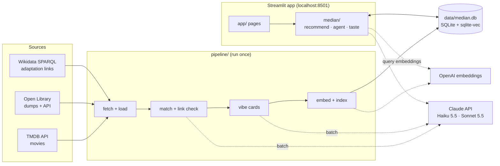
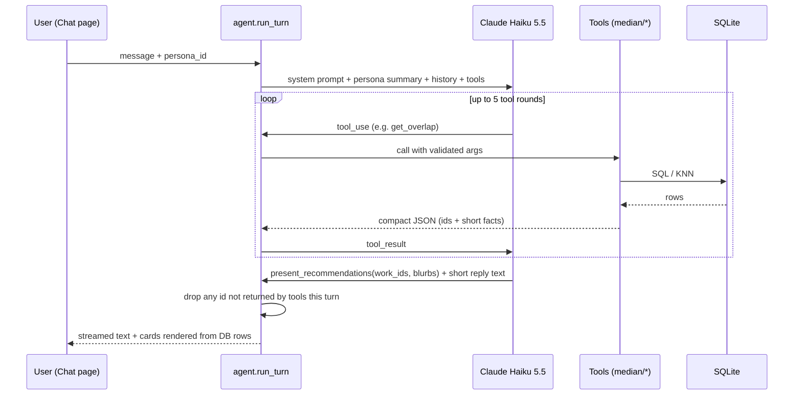

# ARCHITECTURE.md — Median

How Median is built. If code and this doc disagree, fix one of them in the same change.

- **Scope:** local, single-laptop demo for a class project. No auth, no hosting.
- **Stack:** Python 3.12 · Streamlit · SQLite + sqlite-vec · Claude (Haiku 5.5, Sonnet 5.5) ·
  OpenAI text-embedding-3-small · TMDB, Open Library, Wikidata.

---

## 1. System overview

Median has two halves that meet only in one SQLite file:

1. **Offline pipeline** (`pipeline/`): runs from the command line before the demo. It downloads
   movie and book data, links them, writes a vibe card for each work, embeds the cards and writes
   everything to `data/median.db`.
2. **Streamlit app** (`app/` + `median/`): reads the catalog, stores persona shelves, ratings and
   chats, and calls Claude for the chat agent and explanations.



The team shares the finished `median.db` file (about 300–400 MB) through a shared drive, so the
paid pipeline runs once rather than once per laptop.

---

## 2. Data model

`db/schema.sql` is the source of truth. Summary:

```sql
-- Catalog -------------------------------------------------------------
CREATE TABLE IF NOT EXISTS works (
  id          INTEGER PRIMARY KEY,
  media_type  TEXT NOT NULL CHECK (media_type IN ('movie','book','tv','music')),
  title       TEXT NOT NULL,
  year        INTEGER,
  creators    TEXT,            -- JSON array of names (directors/authors)
  synopsis    TEXT,
  subjects    TEXT,            -- JSON array: genres, TMDB keywords, OL subjects
  popularity  REAL,            -- 0..1 percentile within media_type
  cover_url   TEXT
);

CREATE TABLE IF NOT EXISTS external_ids (
  work_id     INTEGER NOT NULL REFERENCES works(id),
  source      TEXT NOT NULL CHECK (source IN ('tmdb','openlibrary','wikidata')),
  external_id TEXT NOT NULL,
  PRIMARY KEY (source, external_id)
);

CREATE TABLE IF NOT EXISTS work_links (
  from_work   INTEGER NOT NULL REFERENCES works(id),
  to_work     INTEGER NOT NULL REFERENCES works(id),
  link_type   TEXT NOT NULL CHECK (link_type IN ('adaptation_of','same_franchise','same_creator')),
  source      TEXT NOT NULL CHECK (source IN ('wikidata','tmdb_credits','title_match')),
  confidence  REAL NOT NULL DEFAULT 1.0,   -- 0..1
  verified    INTEGER NOT NULL DEFAULT 0,  -- 1 = passed LLM link check or from Wikidata
  PRIMARY KEY (from_work, to_work, link_type)
);
-- adaptation_of: from_work (movie) is adapted from to_work (book)

CREATE TABLE IF NOT EXISTS vibe_cards (
  work_id        INTEGER PRIMARY KEY REFERENCES works(id),
  card_json      TEXT NOT NULL,    -- validated VibeCard (see §4)
  card_text      TEXT NOT NULL,    -- flattened text that was embedded
  model          TEXT NOT NULL,
  prompt_version TEXT NOT NULL
);

-- Vector index (sqlite-vec). media_type is a metadata column, so KNN can filter on it.
CREATE VIRTUAL TABLE IF NOT EXISTS vec_vibes USING vec0(
  work_id    INTEGER PRIMARY KEY,
  embedding  float[1536] distance_metric=cosine,
  media_type TEXT
);

-- Keyword search over titles and creators
CREATE VIRTUAL TABLE IF NOT EXISTS works_fts USING fts5(
  title, creators, content='works', content_rowid='id'
);

CREATE TABLE IF NOT EXISTS meta (key TEXT PRIMARY KEY, value TEXT);
-- keys: schema_version, embedding_model, embedding_dims, catalog_built_at, vibe_prompt_version

-- Personas and their data --------------------------------------------
CREATE TABLE IF NOT EXISTS personas (
  id           INTEGER PRIMARY KEY,
  name         TEXT NOT NULL,
  description  TEXT,
  taste_vector BLOB,             -- float32[1536], NULL until >= 3 signals
  updated_at   TEXT
);

CREATE TABLE IF NOT EXISTS shelf_items (
  persona_id INTEGER NOT NULL REFERENCES personas(id),
  work_id    INTEGER NOT NULL REFERENCES works(id),
  shelf      TEXT NOT NULL CHECK (shelf IN ('want','in_progress','finished','favorite')),
  rating     INTEGER CHECK (rating BETWEEN 1 AND 10),   -- 10-point = half-star UI
  note       TEXT,
  added_at   TEXT NOT NULL DEFAULT CURRENT_TIMESTAMP,
  PRIMARY KEY (persona_id, work_id)
);

CREATE TABLE IF NOT EXISTS chat_messages (
  id              INTEGER PRIMARY KEY,
  persona_id      INTEGER NOT NULL REFERENCES personas(id),
  session_id      TEXT NOT NULL,
  role            TEXT NOT NULL CHECK (role IN ('user','assistant')),
  content         TEXT NOT NULL,
  recommended_ids TEXT,          -- JSON array of work ids shown as cards
  created_at      TEXT NOT NULL DEFAULT CURRENT_TIMESTAMP
);

CREATE TABLE IF NOT EXISTS rec_feedback (
  id         INTEGER PRIMARY KEY,
  persona_id INTEGER NOT NULL REFERENCES personas(id),
  work_id    INTEGER NOT NULL REFERENCES works(id),
  seed_id    INTEGER REFERENCES works(id),
  signal     TEXT NOT NULL CHECK (signal IN ('up','down')),
  created_at TEXT NOT NULL DEFAULT CURRENT_TIMESTAMP
);

CREATE TABLE IF NOT EXISTS explanations (       -- cache of Sonnet "Why?" answers
  persona_id INTEGER NOT NULL, work_id INTEGER NOT NULL,
  seed_id    INTEGER NOT NULL DEFAULT 0,   -- 0 = no seed work (taste-based)
  text       TEXT NOT NULL,
  PRIMARY KEY (persona_id, work_id, seed_id)
);

CREATE TABLE IF NOT EXISTS llm_usage (
  id INTEGER PRIMARY KEY, purpose TEXT, model TEXT,
  input_tokens INTEGER, output_tokens INTEGER, cost_usd REAL,
  created_at TEXT NOT NULL DEFAULT CURRENT_TIMESTAMP
);
```

**Personas** replace user accounts. `db/seed_personas.sql` creates 3–4 personas (e.g. "Horror fan",
"Cozy mystery reader", "Epic fantasy fan", "Literary drama"), each with about 8 pre-rated works,
so taste-based recommendations work from the first click. (M0 seeds the persona rows only; the
pre-rated works are added in M2, once a catalog exists to rate.)

---

## 3. Database access

- `median.db.connect(path=None) -> sqlite3.Connection` is the only way to open the DB. It:
  1. opens the file (default from `MEDIAN_DB_PATH`),
  2. `enable_load_extension(True)` → `sqlite_vec.load(conn)` → `enable_load_extension(False)`,
  3. sets `PRAGMA foreign_keys=ON`, `PRAGMA journal_mode=WAL`, `row_factory=sqlite3.Row`.
- `init_db(path=None, seed=True)` applies `db/schema.sql`, writes `meta.schema_version` and seeds the
  personas (idempotent). If an existing file has a different `SCHEMA_VERSION` it raises
  `SchemaVersionError` (rebuild or get a matching `median.db`). `ensure_db()` calls `init_db` only
  when the file is missing, so a fresh clone can start the app before any catalog exists; a shared
  `median.db` copied into `data/` is used untouched.
- `works_fts` is an external-content FTS5 table: call `median.db.rebuild_fts(conn)` after loading
  or changing `works` (the pipeline's `index` step does this).
- Vectors are written with `sqlite_vec.serialize_float32(list[float])` (`median.db.vec_to_blob`).
- Verified on sqlite-vec 0.1.9 (pinned): `distance_metric=cosine` and the `media_type` metadata
  filter in the KNN query below both work, and `tests/test_db.py` covers them.
- KNN query pattern:

  ```sql
  SELECT work_id, distance
  FROM vec_vibes
  WHERE embedding MATCH :query_vec
    AND k = :k
    AND media_type = :media_type      -- optional metadata filter
  ORDER BY distance;
  ```
  Cosine distance is 0 for identical vectors; similarity = `1 - distance`.
- **Threads:** Streamlit runs each script rerun in its own thread. Don't share one connection
  across threads; open one per rerun (cheap) or keep one in `st.session_state`.
- **Python build:** some system Pythons (notably macOS's) can't load SQLite extensions. Use the
  uv-managed Python (`uv python install 3.12`), which can.
- **Speed:** sqlite-vec scans every vector (brute force). Scanning 40,000 × 1,536 floats takes well
  under a second on a laptop, which is fine for a demo. If it feels slow, filter by `media_type` first.

---

## 4. Vibe cards (the key design choice)

Movie overviews and book blurbs are written in different styles, so embedding them directly would
group items by media type rather than by feel. Instead, Haiku rewrites every work into one
**media-neutral template**, and only that is embedded.

```python
class VibeCard(BaseModel):          # median/models.py (pydantic)
    logline: str                    # 1 spoiler-free sentence about the story, not the medium
    themes: list[str]               # 3-6, e.g. "grief", "found family", "ambition"
    mood: list[str]                 # 3-5 adjectives, e.g. "eerie", "warm", "melancholic"
    tone: str                       # e.g. "darkly comic", "earnest", "bleak"
    setting: str                    # time + place, e.g. "1920s rural Mississippi"
    pacing: Literal["slow", "medium", "fast"]
    intensity: Literal["low", "medium", "high"]   # violence/fear/emotional weight
    audience: Literal["children", "young_adult", "adult"]
    hooks: list[str]                # 2-4 story hooks, e.g. "unreliable narrator", "heist"
```

Rules (enforced in `median/prompts/vibe_card.md`):
- Never mention the medium ("film", "novel", "reader", "viewer", "chapter", "cinematography").
- No titles, character names or creator names; they would pull adaptations together for the
  wrong reason, and direct links already cover that.
- Work only from the provided synopsis and subjects; return `unknown` rather than guessing.

`card_text` is the flattened card (`"Themes: ... Mood: ... Tone: ..."`) and is what gets embedded.
Changing the template means regenerating every card: bump `VIBE_PROMPT_VERSION` in config.

---

## 5. Overlap and recommendation scoring (`median/recommend.py`)

`overlap(seed_id, target_media, persona_id=None, k=10) -> list[Recommendation]`

**Candidate generation**
1. *Link candidates:* all `work_links` rows touching the seed, in both directions (and one hop
   through a shared franchise).
2. *Vibe candidates:* KNN over `vec_vibes` from the seed's vector, `k=100`, filtered to
   `target_media` when it isn't `any`.

**Score** (weights in `config.py`, tuned with the eval set):

```
score = 0.45 * link_strength      # adaptation 1.0 · franchise 0.8 · creator 0.5, × confidence
      + 0.35 * vibe_similarity    # 1 - cosine distance to the seed
      + 0.15 * taste_similarity   # 1 - cosine distance to the persona taste vector (0 if none)
      + 0.05 * popularity         # percentile within media type
```

**Filters and diversity**
- Remove the seed itself and anything already on the persona's shelves.
- At most 2 results from the same franchise in the top 10.

**Reasons**: each `Recommendation` carries machine-made reasons that the UI shows and the
explainer uses: `"Adapted from <title>"`, `"Same series"`, `"Shared themes: grief, found family"`
(the intersection of the two cards' themes and moods).

`for_persona(persona_id, target_media, mood_query=None, k=10)` is the same scorer, seeded by the
persona's taste vector, blended with the embedding of `mood_query` if one is given.

### Taste vector (`median/taste.py`)

A weighted mean of the vibe vectors of works the persona has interacted with, then normalized:

| Signal | Weight |
| --- | --- |
| rating r (1–10) | (r − 5.5) / 4.5 → −1..+1 |
| shelf `favorite` | +1.0 |
| thumbs up / down on a recommendation | +0.5 / −0.5 |

Recompute on every rating, shelf or feedback change. It stays NULL until there are at least 3 signals.

---

## 6. Chat agent (`median/agent.py`)

Haiku 5.5 with tool use; streamed into `st.chat_message` via `st.write_stream`.



**Tools** (JSON schemas live in `median/agent.py`):

| Tool | Arguments | Returns |
| --- | --- | --- |
| `search_works` | `query`, `media_type` (movie/book/any), `limit≤10` | FTS5 title/creator matches, then semantic matches |
| `get_work` | `work_id` | Title, year, creators, vibe card, links |
| `get_overlap` | `work_id`, `target_media`, `limit≤10` | `recommend.overlap(...)` with reasons |
| `recommend_for_persona` | `target_media`, `mood_query?`, `limit≤10` | `recommend.for_persona(...)` |
| `get_persona_shelf` | `shelf?` | The persona's shelved works and ratings |
| `present_recommendations` | `work_ids` (≤6), `blurbs` {id: 1 sentence} | **Final step**: the UI renders these |

**Guardrails**
- Max 5 tool rounds per turn, max ~4k input tokens of tool results (truncate lists).
- `present_recommendations` IDs must be a subset of IDs returned by tools in this turn; drop any
  others and log a warning (tested in `tests/test_agent_guardrails.py`).
- Catalog text goes inside `<work_data>` tags; the system prompt says to treat it as data.
- On API failure: retry up to 3 times with backoff (tenacity), then show a friendly error; browsing
  still works offline.

**Explanations:** a "Why?" button on any card calls Sonnet 5.5 with the persona summary, the seed's
and the target's vibe cards, the link facts and the reasons. It returns 2–3 sentences, cached in
`explanations`.

---

## 7. Offline pipeline (`pipeline/build.py`)

Every step is idempotent and resumable: `--step <name>` runs one step, `--sample` builds a small
catalog. Raw responses are cached in `data/cache/`.

| # | Step | What it does | Notes |
| --- | --- | --- | --- |
| 1 | `fetch_tmdb` | Top ~20k movies by popularity; details with `append_to_response=keywords,credits,external_ids` | TMDB caps list pagination; slice discover queries by year range. Cache every response |
| 2 | `load_openlibrary` | Stream the works, authors and reading-log dumps; keep the top ~20k works by reading-log count that have a description or subjects | Stream with `gzip`, never load whole dumps into memory |
| 3 | `wikidata_links` | SPARQL: films with a TMDB ID that are "based on" (P144) or in a series (P179) with works that have an Open Library ID | Check property IDs on wikidata.org before relying on them |
| 4 | `match` | Join on IDs; add candidate adaptations from TMDB credits (crew jobs like "Novel"/"Book") matched to OL title + author with `rapidfuzz` | Candidates start with `verified=0` |
| 5 | `link_check` | Haiku batch: "Is film X adapted from book Y?" → yes/no + confidence for unverified links | Drop below 0.7 |
| 6 | `vibe_cards` | Haiku batch: one VibeCard per work; validate with pydantic; retry invalid ones once | ~$4 for 40k works |
| 7 | `embed` | OpenAI embeddings for `card_text`, 256 inputs per request | ~$0.20 for 40k works |
| 8 | `index` | Fill `vec_vibes`, rebuild `works_fts`, compute popularity percentiles, write `meta` | |
| 9 | `report` | Print counts, link coverage, % of works with cards, total spend | |

**Review set:** before the full sample, `python -m pipeline.enrich.vibe_cards` builds a 50-work set
(25 movies + 25 books, 5 adaptation pairs, listed in `pipeline/sample_seed.py`) from TMDB and Open
Library one-off API lookups, generates cards with the regular API (not batch, since 50 calls is not
bulk) and writes `data/vibe_review.md` for the team to read before the template is frozen.

**`--sample` mode:** 1,000 movies + 1,000 books, including at least 100 known adaptation pairs from
step 3, so overlap is demo-able in development.

---

## 8. Streamlit UI (`app/`)

| Page | Purpose |
| --- | --- |
| `Home.py` | Intro, persona picker (sidebar, persists in `st.session_state["persona_id"]`), quick search |
| `pages/1_Browse.py` | Search and filter the catalog (media type, year, mood) |
| `pages/2_Work.py` | Work detail: cover, vibe card, **Linked** (adaptations/franchise) and **Similar vibe** (other medium) sections, shelf + rating controls |
| `pages/3_Shelves.py` | Persona shelves: want / in progress / finished / favorite |
| `pages/4_Chat.py` | Chat with the agent; recommendation cards with 👍/👎 and "Why?" |
| `pages/5_Taste.py` | Taste profile: top themes and moods from the taste vector's nearest cards, rating history |
| `pages/6_Credits.py` | TMDB attribution + logo, Open Library and Wikidata credits |

The sidebar persona picker appears on every page. Shared rendering lives in `app/components.py`
(page setup, persona picker, per-rerun `db_conn()`; later the work card, recommendation card and
rating widget).

`pyproject.toml` installs `median`, `pipeline` and `app` as an editable package (`uv sync`), so
pages import with `from app.components import ...` and `from median... import ...`. Streamlit only
puts the script's own folder on `sys.path`, so without the install `median` would not be importable.

---

## 9. Configuration (`.env`, read by `median/config.py`)

| Variable | Purpose |
| --- | --- |
| `ANTHROPIC_API_KEY` | Claude API |
| `OPENAI_API_KEY` | Embeddings |
| `TMDB_API_READ_TOKEN` | TMDB v4 read access token (Bearer) |
| `CONTACT_EMAIL` | Used in the User-Agent for Open Library and Wikidata |
| `MEDIAN_DB_PATH` | Default `data/median.db` |
| `DAILY_USD_LIMIT` | Hard stop for LLM spend per day (default `2`) |

Constants in `config.py`: `AGENT_MODEL="claude-haiku-5-5"`, `EXPLAIN_MODEL="claude-sonnet-5-5"`,
`EMBED_MODEL="text-embedding-3-small"`, `EMBED_DIMS=1536`, `VIBE_PROMPT_VERSION`,
`SCHEMA_VERSION`, score weights, price table for `llm_usage.cost_usd`.

---

## 10. Evaluation (`tests/eval/`, run with `uv run pytest -m eval`)

| File | Contents |
| --- | --- |
| `gold_adaptations.csv` | ~50 (book OL id, movie TMDB id) pairs known to be adaptations |
| `gold_vibes.csv` | ~30 (seed, target, why) cross-media pairs the team agrees feel alike |

Metrics, printed as a table:
- **Adaptation recall@10:** for each book, is its film in `overlap(book, 'movie')[:10]`? Target ≥ 0.9.
- **Vibe recall@10:** target in top 10 for the seed? Target ≥ 0.5.
- **Medium-mixing check:** share of `target_media='any'` results that are the other medium.
  It should not be near 0 (that would mean the vibe cards leak the medium).

Run the eval after any change to scoring weights, prompts or the card template, and show the
numbers in the demo.

---

## 11. Known limits and future path

- Data is limited to what TMDB, Open Library and Wikidata provide; there are no review texts.
- Wikidata covers only about a third of known film–novel adaptations, hence steps 4–5.
- The demo needs internet for chat; browsing and cards work offline once the DB exists.
- **Going online later:** move to Postgres + pgvector (same schema shape), add real accounts, and
  replace Streamlit with a web frontend. TV and music need only a new `media_type`, a source loader
  and vibe cards; the scorer and agent don't change.
